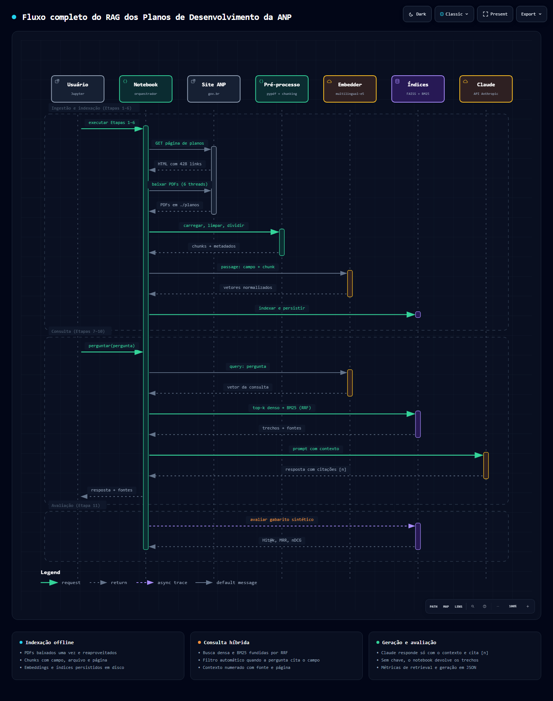

# RAG sobre os Sumários Executivos dos Planos de Desenvolvimento de Campos da ANP

#### Aluno: [Ricardo Coelho](https://github.com/ricardo-coelho-4crux)
#### Orientadora: Evelyn

---

Trabalho apresentado ao curso [GenAI e LLM MASTER](https://ica.ele.puc-rio.br/cursos/ia-generativa-large-language-models/) como pré-requisito para conclusão de curso e obtenção de crédito na disciplina "Projetos de Sistemas Inteligentes de Apoio à Decisão".

- [Link para o código](rag_anp_planos_desenvolvimento.ipynb).

- [Notebook executado, com as saídas e métricas](rag_anp_planos_desenvolvimento_executado.ipynb).

- [Diagrama de sequência do fluxo completo (HTML interativo)](docs/diagrama-sequencia-rag.html).

---

### Resumo

Este trabalho implementa, em um único Jupyter Notebook, um sistema de *Retrieval-Augmented Generation* (RAG) que responde perguntas em português sobre os Sumários Executivos dos Planos de Desenvolvimento de campos de petróleo e gás publicados pela Agência Nacional do Petróleo, Gás Natural e Biocombustíveis (ANP). O corpus reúne 428 PDFs, um por campo, obtidos automaticamente da página oficial da agência.

O pipeline cobre todas as etapas usuais de um RAG: aquisição dos documentos, extração de texto por página, limpeza, divisão em *chunks* com metadados (campo, arquivo e página), geração de *embeddings* com o modelo multilíngue `multilingual-e5-small`, indexação em FAISS, recuperação híbrida (busca densa e BM25 combinadas por *Reciprocal Rank Fusion*, com filtro automático quando a pergunta cita o campo), montagem do prompt com citações numeradas e geração da resposta por um LLM (Claude), com um modo extrativo quando não há chave de API.

Para avaliar o sistema, foi construído automaticamente um gabarito sintético de 1.000 perguntas factuais a partir da ficha estruturada de cada sumário (operador, bacia, estado, fluido principal e início de produção). Com recuperação híbrida e filtro de campo, o trecho correto aparece entre os 6 primeiros em 100% das perguntas e em 97,6% entre os 3 primeiros, com MRR de 0,789 e latência mediana de 8,8 ms. Sem o filtro, a busca híbrida alcança Hit@6 de 98,0%. Em uma amostra de 40 perguntas, a geração com o Claude Sonnet 5.5 obteve 100% de correção e de citação das fontes, 97,5% de fidelidade ao contexto recuperado e 100% de abstenção correta em perguntas sobre campos inexistentes.

### Abstract

This work implements, in a single Jupyter Notebook, a Retrieval-Augmented Generation (RAG) system that answers Portuguese-language questions about the Executive Summaries of Development Plans for oil and gas fields published by Brazil's National Agency of Petroleum, Natural Gas and Biofuels (ANP). The corpus comprises 428 PDFs, one per field, downloaded automatically from the agency's official page.

The pipeline covers all standard RAG stages: document acquisition, page-level text extraction, cleaning, chunking with metadata (field, file, page), embeddings with the multilingual `multilingual-e5-small` model, FAISS indexing, hybrid retrieval (dense search and BM25 fused with Reciprocal Rank Fusion, with automatic field filtering when the question names the field), prompt assembly with numbered citations, and answer generation by an LLM (Claude), with an extractive fallback when no API key is available.

For evaluation, a synthetic benchmark of 1,000 factual questions was automatically built from each summary's structured data sheet (operator, basin, state, main fluid, production start). With hybrid retrieval and field filtering, the correct passage is in the top 6 for 100% of questions and in the top 3 for 97.6%, with an MRR of 0.789 and a median latency of 8.8 ms. Without the filter, hybrid search reaches Hit@6 of 98.0%. On a sample of 40 questions, generation with Claude Sonnet 5.5 achieved 100% correctness and source citation, 97.5% faithfulness to the retrieved context, and 100% correct abstention on questions about non-existent fields.

### 1. Introdução

A ANP publica, para cada campo de petróleo e gás em desenvolvimento ou produção no Brasil, um Sumário Executivo do Plano de Desenvolvimento aprovado. Esses documentos concentram informações como operador, concessionários e participações, bacia, lâmina d'água, fluido principal, datas de declaração de comercialidade e de início de produção e o sistema de produção adotado. Eles estão espalhados em centenas de PDFs distintos, listados em uma única página, sem busca textual nem consulta estruturada. Responder uma pergunta simples, como "quem opera o campo X?", exige localizar o PDF certo e lê-lo.

Modelos de linguagem não resolvem isso sozinhos: não têm garantia de conhecer documentos específicos e recentes e tendem a inventar valores plausíveis. A arquitetura RAG (Lewis et al., 2020) ataca o problema recuperando os trechos relevantes e condicionando a resposta a eles, com a vantagem de permitir citar a fonte.

O objetivo deste trabalho é construir e avaliar um RAG completo e reprodutível sobre esse corpus, documentando cada etapa do pipeline em um notebook executável, de modo que quem o receba consiga repetir o processo do download dos PDFs até a avaliação das métricas.

### 2. Modelagem

O fluxo completo está no diagrama de sequência abaixo ([versão interativa em HTML](docs/diagrama-sequencia-rag.html), gerada com o Archify; o código-fonte do diagrama está em [`docs/diagrama-sequencia-rag.spec.json`](docs/diagrama-sequencia-rag.spec.json)).



**Dados.** A Etapa 1 lê a página de planos da ANP, extrai os links dos PDFs e baixa os 428 arquivos (240,8 MB) para `planos/`, em paralelo e com novas tentativas. Arquivos já existentes são pulados. O nome do campo vem do texto do link.

**Carga e limpeza.** O texto é extraído página a página com `pypdf`, sem necessidade de OCR (nenhum PDF veio sem camada de texto). A limpeza normaliza unicode, junta palavras hifenizadas na quebra de linha e remove linhas repetidas (cabeçalhos e rodapés) em documentos longos. São extraídas 1.123 páginas, das quais 907 têm texto útil após a limpeza (cerca de 1,15 milhão de caracteres, estimados em 288 mil tokens).

**Chunking.** Divisão recursiva (parágrafo, linha, frase, palavra) em trechos de até 1.000 caracteres, com sobreposição de 150 caracteres cortada em limite de palavra. Cada chunk guarda campo, arquivo, URL e página. Resultam 1.693 chunks, com média de 733 caracteres e cerca de 4 chunks por PDF.

**Embeddings e índice.** O texto indexado é prefixado com o nome do campo (`passage: Campo X. ...`), para que perguntas que citam o campo casem mesmo quando a página não repete o nome. Foi usado `intfloat/multilingual-e5-small` (384 dimensões, Wang et al., 2024), com vetores normalizados e índice FAISS de produto interno (Johnson et al., 2019). O cache dos vetores é validado por hash do modelo e do conteúdo dos chunks, de modo que uma mudança no chunking nunca reaproveita vetores antigos.

**Recuperação híbrida.** A busca densa (similaridade de cosseno) e a busca lexical BM25 (Robertson e Zaragoza, 2009) são combinadas por *Reciprocal Rank Fusion* (Cormack et al., 2009). Se a pergunta cita o nome de um campo, o resultado é filtrado para ele; os nomes são comparados do mais longo ao mais curto, para que "Albacora Leste" vença "Albacora".

**Geração.** O prompt contém os trechos numerados com campo, arquivo e página, e instrui o modelo a responder apenas com o contexto, citar `[n]` e admitir quando não encontrar a informação. Com `ANTHROPIC_API_KEY` definida (no ambiente ou em um arquivo `.env`), a resposta é gerada pelo Claude Sonnet 5.5 (`claude-sonnet-5-5`); sem a chave, o notebook devolve os trechos mais relevantes.

**Avaliação.** A Etapa 11 do notebook reúne:

- estatísticas do corpus e do índice;
- 13 testes automatizados do pipeline (PDFs, limpeza, chunking, embeddings, índice, detecção de campo, filtro, ordenação, prompt e geração extrativa);
- métricas de recuperação sobre um gabarito sintético, construído automaticamente a partir da ficha estruturada que abre cada sumário (`Operador do Contrato`, `Bacia`, `Estado`, `Fluido Principal`, `Início de Produção`). Para cada campo geram-se perguntas em linguagem natural, e é considerado relevante todo chunk do mesmo PDF que contém a linha-resposta;
- métricas de geração (correção, taxa de citação, fidelidade e relevância avaliadas por LLM-juiz, e abstenção correta em perguntas sobre campos inexistentes), que só executam com chave de API.

### 3. Resultados

Todos os valores abaixo foram obtidos na execução registrada em [`rag_anp_planos_desenvolvimento_executado.ipynb`](rag_anp_planos_desenvolvimento_executado.ipynb) e consolidados em [`metricas_rag.json`](metricas_rag.json). O gabarito tem 1.000 perguntas (operador: 219, estado: 204, fluido: 209, bacia: 189, início de produção: 179), e `k = 6`.

**Corpus e índice**

| Item | Valor |
|---|---|
| PDFs / campos distintos | 428 / 428 |
| Páginas com texto útil | 907 (média de 2,1 por PDF) |
| Chunks | 1.693 (média de 733 caracteres, máximo de 1.138) |
| Chunks duplicados | 0,71% |
| Dimensão dos embeddings / tamanho do índice | 384 / 2,6 MB |

**Testes automatizados:** 13 de 13 passaram. Durante o desenvolvimento, o teste de divisão de texto longo detectou que a sobreposição cortava palavras no meio; o chunker foi corrigido para cortar em limite de palavra.

**Recuperação**

| Estratégia | Hit@1 | Hit@3 | Hit@6 | MRR | nDCG@6 | Campo correto @1 | Latência p50 / p95 (ms) |
|---|---|---|---|---|---|---|---|
| Denso, sem filtro | 0,567 | 0,886 | 0,971 | 0,730 | 0,790 | 0,948 | 6,1 / 10,4 |
| BM25, sem filtro | 0,616 | 0,892 | 0,960 | 0,755 | 0,806 | 0,843 | 8,2 / 9,3 |
| Híbrido RRF, sem filtro | 0,597 | 0,933 | 0,980 | 0,765 | 0,820 | 0,940 | 8,4 / 9,4 |
| **Híbrido + filtro de campo** | **0,615** | **0,976** | **1,000** | **0,789** | **0,843** | **1,000** | 8,8 / 9,9 |

Precision@6 ficou em 0,16 a 0,17 e Recall@6 coincide com o Hit@6, porque cada pergunta tem em geral um único chunk relevante (o teto de Precision@6 nesse caso é 1/6 ≈ 0,167).

Leituras e ressalvas:

- A busca híbrida supera as duas isoladas em Hit@3, Hit@6, MRR e nDCG. A busca densa acerta melhor o campo (94,8% contra 84,3% do BM25), e o BM25 acerta melhor o chunk exato.
- O filtro por campo elimina os erros de campo (100% de campo correto @1). O Hit@6 de 100% com filtro é em parte consequência de cada PDF ter, em média, apenas 4 chunks, menor que `k = 6`. As métricas que realmente discriminam são Hit@1 e MRR.
- Hit@1 de 0,615 indica que, dentro do documento certo, o chunk com a linha-resposta nem sempre é o primeiro. Como a ficha estruturada se espalha por poucos chunks, perguntas diferentes sobre o mesmo campo ativam trechos parecidos.
- As perguntas são factuais e extraídas de um formulário. O gabarito mede recuperação de forma objetiva, mas é um proxy: perguntas analíticas (por exemplo, "como será o desenvolvimento do campo?") exigiriam julgamento humano.

**Geração** (Claude Sonnet 5.5, 40 perguntas do gabarito mais 5 perguntas sobre campos inexistentes)

| Métrica | Valor |
|---|---|
| Correção (o valor esperado aparece na resposta) | 100% |
| Taxa de citação (a resposta cita `[n]`) | 100% |
| Fidelidade ao contexto (LLM-juiz) | 97,5% |
| Relevância da resposta (LLM-juiz) | 97,5% |
| Abstenção correta em campos inexistentes (LLM-juiz, n = 5) | 100% |

Ressalvas sobre a geração: a amostra é pequena (40 perguntas e 5 de abstenção), de modo que um erro isolado muda a métrica em 2,5 pontos. O juiz é o mesmo modelo que gera as respostas, o que tende a favorecê-lo; um juiz independente ou revisão humana tornaria a medida mais confiável. A correção é alta em boa parte porque as perguntas são factuais e o contexto recuperado quase sempre contém a resposta.

### 4. Conclusões

O notebook entrega um RAG completo, do download dos 428 PDFs à avaliação, que roda do início ao fim e é verificado por testes automatizados. Em recuperação, a combinação de busca densa e lexical com filtro automático por campo foi a melhor estratégia, localizando o trecho correto entre os 3 primeiros em 97,6% das perguntas e em menos de 10 ms. O modelo `multilingual-e5-small`, pequeno e executável em CPU, foi suficiente para este corpus.

Limitações e próximos passos:

- Ampliar a avaliação da geração: amostra maior, juiz independente do modelo gerador e um conjunto de perguntas e respostas elaborado por especialistas, incluindo perguntas analíticas e comparativas entre campos.
- Melhorar o Hit@1 com um *reranker* (cross-encoder) ou com chunks alinhados às seções da ficha.
- Testar modelos de embedding maiores (`-base`, `-large`) e ajustar tamanho e sobreposição dos chunks.
- Tratar PDFs escaneados com OCR caso o corpus passe a incluí-los (hoje nenhum precisa).
- Detectar atualizações de PDFs que mantêm o mesmo nome de arquivo.

### 5. Referências

- ANP. *Planos de Desenvolvimento*. https://www.gov.br/anp/pt-br/assuntos/exploracao-e-producao-de-oleo-e-gas/desenvolvimento-e-producao/planos-de-desenvolvimento
- Lewis, P. et al. *Retrieval-Augmented Generation for Knowledge-Intensive NLP Tasks*. NeurIPS, 2020. https://arxiv.org/abs/2005.11401
- Wang, L. et al. *Multilingual E5 Text Embeddings: A Technical Report*. 2024. https://arxiv.org/abs/2402.05672
- Johnson, J.; Douze, M.; Jégou, H. *Billion-scale similarity search with GPUs*. IEEE Transactions on Big Data, 2019. https://arxiv.org/abs/1702.08734
- Robertson, S.; Zaragoza, H. *The Probabilistic Relevance Framework: BM25 and Beyond*. Foundations and Trends in Information Retrieval, 2009.
- Cormack, G. V.; Clarke, C. L. A.; Büttcher, S. *Reciprocal Rank Fusion outperforms Condorcet and individual Rank Learning Methods*. SIGIR, 2009.
- Järvelin, K.; Kekäläinen, J. *Cumulated gain-based evaluation of IR techniques*. ACM TOIS, 2002.
- Es, S. et al. *RAGAs: Automated Evaluation of Retrieval Augmented Generation*. 2023. https://arxiv.org/abs/2309.15217

### 6. Instalação

Requer Python 3.9 a 3.12 e conexão com a internet na primeira execução (download dos PDFs e do modelo de embeddings, cerca de 240 MB e 470 MB). Recomenda-se um ambiente virtual:

```bash
python -m venv .venv
.venv\Scripts\activate        # Linux/macOS: source .venv/bin/activate
pip install -r requirements.txt
```

O `requirements.txt` fixa versões compatíveis entre si (`numpy<2`, `transformers` 4.4x, `sentence-transformers` 3.x). Para usar GPU NVIDIA, instale antes o PyTorch com CUDA (https://pytorch.org/get-started/locally/); sem GPU, tudo roda em CPU.

### 7. Como executar

1. Abra `rag_anp_planos_desenvolvimento.ipynb` no Jupyter ou no VS Code, com o ambiente virtual selecionado como kernel.
2. (Opcional) Defina `ANTHROPIC_API_KEY` para respostas geradas pelo Claude e para as métricas de geração, de uma destas formas:

   ```bash
   set ANTHROPIC_API_KEY=sua_chave          # Linux/macOS: export ANTHROPIC_API_KEY=sua_chave
   ```

   ou crie um arquivo `.env` ao lado do notebook com a linha `ANTHROPIC_API_KEY=sua_chave`. Há um modelo pronto em [`.env.example`](.env.example): copie-o para `.env` e troque o valor (o `.gitignore` já exclui o `.env` do repositório, então a chave não é enviada ao GitHub). Sem a chave, o notebook roda em modo extrativo.

3. Execute as células em ordem (*Run All*). Na primeira vez, o notebook baixa os PDFs para `planos/`, gera o índice em `index/` e grava `metricas_rag.json`. Nas execuções seguintes, PDFs e embeddings são reaproveitados.
4. Use `perguntar("sua pergunta")` (Etapa 10) para consultar, por exemplo: `perguntar("Qual a bacia do campo de Búzios?")`.

---

Matrícula: 252.100.041

Pontifícia Universidade Católica do Rio de Janeiro

Curso de Pós Graduação *Inteligência Artificial Generativa & Large Language Models*
